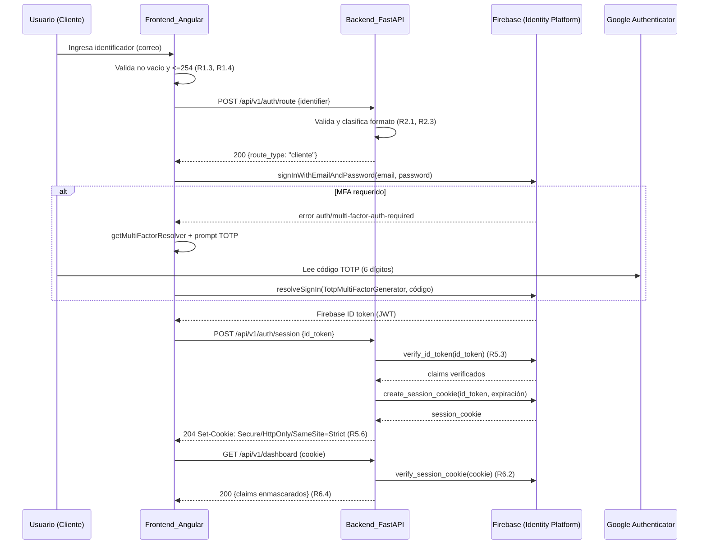
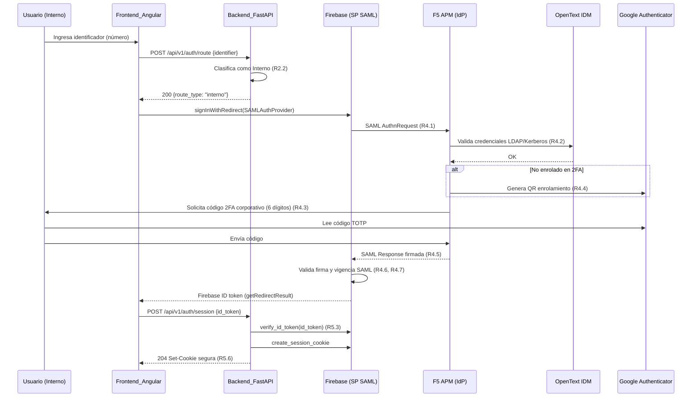

# Design Document

## Overview

Esta PoC implementa autenticación con segundo factor (2FA TOTP) para una aseguradora, con dos poblaciones de usuarios y una experiencia de ingreso unificada identifier-first. El objetivo es validar, con componentes reales (sin stubs ni simuladores, conforme a R9.1), que:

- Un **Cliente** se autentica con correo electrónico, donde Firebase / Google Cloud Identity Platform resuelve la identidad y el 2FA TOTP (R3).
- Un **Interno** se autentica con número de identificación, donde Firebase actúa como **Service Provider SAML** federando hacia **F5 APM**, que valida contra **OpenText IDM** (LDAP/Kerberos) y provee el 2FA corporativo (R4).
- El **Backend_FastAPI** decide la ruta Cliente/Interno de forma transparente según el formato del identificador (R2), verifica tokens, entrega la sesión por cookie segura (R5) y protege el dashboard (R6).
- El **Frontend_Angular** presenta un único campo de ingreso, luego el prompt de 2FA y finalmente el dashboard protegido (R1, R6).

### Decisión arquitectónica clave y desviación respecto al diagrama original (Cognito → Firebase)

Los requisitos describen un "Authorization Code Flow de OIDC" (R5), heredado de un diseño previo que asumía **AWS Cognito** como broker con un endpoint OIDC clásico de Authorization Code. **Firebase / Google Cloud Identity Platform no expone un endpoint OIDC de Authorization Code equivalente al de Cognito.** Por tanto, el flujo se materializa de forma honesta con las APIs documentadas de Firebase:

1. El **Frontend_Angular** usa el **Firebase Client SDK (JS)** para autenticar directamente al usuario:
   - Clientes: `signInWithEmailAndPassword` + resolución MFA TOTP (`getMultiFactorResolver`, `TotpMultiFactorGenerator`).
   - Internos: `signInWithRedirect` con `SAMLAuthProvider` → Firebase redirige a F5 APM.
2. El Client SDK devuelve un **Firebase ID token** (JWT firmado por Google).
3. El **Backend_FastAPI** recibe ese ID token y lo **verifica con el Firebase Admin SDK** (`auth.verify_id_token`), validando firma, emisor, audiencia y vigencia (R5.3).
4. El backend crea una **sesión server-side** mediante `auth.create_session_cookie` y la entrega en una cookie `Secure` + `HttpOnly` + `SameSite=Strict` (R5.6), sin devolver tokens en el cuerpo ni usar localStorage.

**Mapeo con R5:** el "intercambio de código por tokens del lado del servidor" (R5.1) se interpreta como "verificación del ID token y creación de la session cookie del lado del servidor". Los secretos (credenciales de la cuenta de servicio del Admin SDK, configuración OIDC/SAML) permanecen exclusivamente en el backend (R5.2). La verificación de firma/emisor/audiencia/vigencia con tolerancia de reloj se realiza en `verify_id_token` y en `verify_session_cookie` (R5.3, R5.5).

Esta desviación es deliberada: evita inventar un endpoint OIDC inexistente en Firebase y respeta el principio de "no inventar APIs". El resultado de seguridad es equivalente: los secretos no salen del servidor y la sesión del navegador es una cookie opaca.

### Alcance de persistencia

La PoC es **stateless** respecto a datos de negocio: la sesión se materializa en la propia session cookie firmada por Firebase (verificable con `verify_session_cookie`), por lo que **no se requiere base de datos**. El único estado efímero es el contador de intentos para los bloqueos por rate limiting (R3.7, R4.10):

- **Local:** almacén en memoria del proceso (diccionario con TTL).
- **GCP (Cloud Run):** dado que Cloud Run escala a múltiples instancias, un contador en memoria no es compartido. Para la PoC se documenta el límite y se ofrece como opción gestionada **Memorystore (Redis)** si se requiere consistencia entre instancias. Nota: el bloqueo de 5 intentos de TOTP de Cliente (R3.7) lo aplica principalmente Firebase; el backend solo refuerza el rate limiting del endpoint `/api/v1/auth/route` y de creación de sesión.

## Architecture

### Diagrama de componentes

```mermaid
graph TB
    subgraph Navegador
        FE[Frontend_Angular<br/>login / 2FA / dashboard<br/>Firebase Client SDK]
    end

    subgraph GCP
        BE[Backend_FastAPI<br/>Cloud Run<br/>enrutamiento + sesión + dashboard]
        FB[Firebase / Identity Platform<br/>OP para Clientes<br/>SP SAML para Internos]
        SM[Secret Manager<br/>credenciales / config]
        HOST[Firebase Hosting<br/>sirve Angular]
    end

    subgraph Corporativo
        F5[F5 APM<br/>IdP SAML + 2FA corporativo]
        IDM[OpenText IDM<br/>LDAP / Kerberos]
    end

    GA[Google Authenticator<br/>genera TOTP]

    FE -->|1. POST /api/v1/auth/route| BE
    FE -->|3. autentica directo| FB
    FE -->|4. POST /api/v1/auth/session (ID token)| BE
    FE -->|GET /api/v1/dashboard (cookie)| BE
    BE -->|verify_id_token / create_session_cookie| FB
    BE -->|lee secretos| SM
    FB -->|SAML AuthnRequest Internos| F5
    F5 -->|LDAP / Kerberos| IDM
    F5 -->|QR enrolamiento Interno| GA
    FB -->|QR enrolamiento Cliente| GA
    HOST -.sirve.-> FE
```

El **broker de identidad es Firebase** (no Cognito). El backend nunca habla OIDC directo con un endpoint de Authorization Code: habla con Firebase mediante el Admin SDK.

### Diagrama de secuencia — Flujo Cliente (correo + TOTP)



### Diagrama de secuencia — Flujo Interno (SAML → F5 APM → OpenText IDM)



### Separación de capas

- **Presentación (Angular):** solo UI, validación de forma (no vacío, longitud) y orquestación del Client SDK. Ninguna lógica de negocio de enrutamiento ni de verificación de tokens vive en el frontend (steering: layer separation).
- **Lógica (FastAPI):** decisión de enrutamiento, verificación de tokens, creación/validación de sesión, enmascarado de claims, rate limiting.
- **Persistencia:** no hay BD; la sesión es una cookie firmada por Firebase. El contador de intentos es estado efímero (memoria local / Memorystore en GCP).

### Versionado y contrato

Todas las rutas HTTP se versionan con prefijo `/api/v1/`. La especificación **OpenAPI** generada por FastAPI es la fuente de verdad del contrato (steering: API First).

## Components and Interfaces

### Backend_FastAPI — Endpoints

Todos los endpoints: validación server-side con Pydantic (R10.6), propagación/generación de Correlation-ID (R10.1, R10.2), logging estructurado sin PII (R10.3), errores genéricos al cliente (R10.4, R10.7), HTTPS obligatorio hacia proveedores (R10.5).

#### `POST /api/v1/auth/route`

Decide la ruta Cliente/Interno a partir del identificador y devuelve al frontend qué método de login iniciar (R2). No ejecuta la autenticación; solo clasifica.

- Request body: `RouteRequest`
- Response 200: `RouteResponse`
- Response 422/400: `ErrorResponse` genérico (R2.4) — no revela motivo ni valor recibido.
- Logging: registra la decisión asociada al Correlation-ID, excluyendo el identificador (R2.5).

#### `POST /api/v1/auth/session`

Recibe el Firebase ID token obtenido por el Client SDK, lo verifica con `auth.verify_id_token` (firma, emisor, audiencia, vigencia, tolerancia de reloj ≤ 60 s — R5.3), y crea la session cookie con `auth.create_session_cookie`. Deriva el tipo de usuario (Cliente/Interno) a partir del claim `firebase.sign_in_provider` (`password` → Cliente; `saml.<provider>` → Interno).

- Request body: `SessionRequest`
- Response 204: `Set-Cookie: session=<cookie>; Secure; HttpOnly; SameSite=Strict; Path=/; Max-Age=<bounded>` (R5.6). No devuelve tokens en el cuerpo.
- Response 401: `ErrorResponse` genérico si el token es inválido/expirado (R5.5), sin establecer sesión.

#### `GET /api/v1/dashboard`

Recurso protegido. Valida la session cookie con `auth.verify_session_cookie(cookie, check_revoked=True)` (R6.2). Devuelve nombre, tipo de usuario y claims enmascarados (R6.1, R6.4).

- Autenticación: cookie `session`.
- Response 200: `DashboardResponse`.
- Response 401: `ErrorResponse` si no hay sesión o está expirada/inválida (R6.3); no incluye datos del dashboard.
- Si no hay claims disponibles, el campo `claims` queda vacío y el frontend muestra el mensaje de ausencia de datos (R6.6).

#### `POST /api/v1/auth/logout`

Invalida la sesión: `auth.revoke_refresh_tokens(uid)` y borra la cookie (`Set-Cookie` con `Max-Age=0`). Idempotente: múltiples llamadas producen el mismo estado "sin sesión" (R6.5).

- Response 204: cookie eliminada.

#### Middleware transversal

- **CorrelationIdMiddleware:** si falta `X-Correlation-ID`, genera un UUID v4 (R10.1); lo propaga en llamadas salientes (R10.2) y lo incluye en todos los logs (R10.3).
- **ErrorHandler:** captura excepciones no controladas, responde mensaje genérico sin trazas (R10.4), registra el detalle con el Correlation-ID.
- **StartupValidator:** al arrancar valida que todas las variables de entorno requeridas estén presentes y no vacías; si falta alguna, aborta e indica el nombre de cada variable faltante sin exponer valores (R9.4).

### Frontend_Angular — Estructura

Angular con `HttpClient`, `RxJS`, `inject()` (steering: Angular). Firebase Client SDK para la autenticación directa.

- **`LoginComponent`** (`login`): único campo identifier-first (R1.1). Valida no vacío tras `trim` (R1.3) y longitud ≤ 254 (R1.4). Llama `AuthService.resolveRoute`.
- **`TwoFactorComponent`** (`2fa`): prompt del código TOTP de 6 dígitos; para Cliente usa el MFA resolver; para Interno el 2FA ocurre en el redirect de F5 (este componente maneja el retorno de `getRedirectResult`).
- **`DashboardComponent`** (`dashboard`): muestra nombre, tipo de usuario y claims enmascarados; mensaje de ausencia de datos si no hay claims (R6.6); render ≤ 3 s (R6.1).
- **`AuthService`:** orquesta el Client SDK (`signInWithEmailAndPassword`, `getMultiFactorResolver`, `TotpMultiFactorGenerator`, `SAMLAuthProvider`, `signInWithRedirect`, `getRedirectResult`) y las llamadas al backend (`/auth/route`, `/auth/session`, `/dashboard`, `/auth/logout`). Timeout de 15 s con RxJS (`timeout(15000)`) y reintento conservando el identificador (R1.6).
- **`AuthGuard`:** protege la ruta del dashboard; verifica sesión consultando `/api/v1/dashboard` (fuente de verdad en el backend); redirige a login si no autorizado.
- **Configuración de entorno:** la URL del backend se resuelve de `environment.ts` (local) / `environment.prod.ts` (GCP) (R9.6). Si no hay URL resuelta, `AuthService` impide llamadas y expone error de configuración (R9.7), sin default embebido.

### CLI_Gestion — Scripts de administración de usuarios Cliente

Scripts Python independientes que usan el **Firebase Admin SDK** (`firebase-admin`). No hay endpoints admin en el backend (R7.6). Credenciales desde variable de entorno `GOOGLE_APPLICATION_CREDENTIALS` o archivo fuera de control de versiones (R7.8); si faltan o son inválidas, abortan sin alterar datos y sin exponer el valor (R7.9).

| Comando | API Admin SDK | Comportamiento | Requisito |
|---|---|---|---|
| `crear_usuario --email <correo>` | `auth.create_user(email=...)` | Valida formato RFC 5322 (5–254). Si el correo ya existe (`EmailAlreadyExistsError`), aborta e informa duplicidad. Retorna `uid` + éxito. | R7.1, R7.2 |
| `actualizar_usuario --uid <uid> [campos]` | `auth.update_user(uid, ...)` | Si el `uid` no existe (`UserNotFoundError`), aborta e informa no encontrado. Retorna éxito. | R7.3, R7.5 |
| `eliminar_usuario --uid <uid>` | `auth.delete_user(uid)` | Si el `uid` no existe, aborta e informa no encontrado. Retorna éxito. | R7.4, R7.5 |

Todos validan parámetros con Pydantic/argparse estricto; ante parámetros inválidos, incompletos o claves no esperadas, abortan e identifican el parámetro problemático (R7.7).

### Contratos (resumen de interfaces)

Los modelos Pydantic (sección Data Models) son los DTO permitidos. El dashboard aplica allowlist de campos y enmascarado; nunca se serializan objetos completos (steering: leakage prevention).

## Data Models

Modelos Pydantic v2 en el backend. Validación estricta: tipos, longitud, formato, rango; rechazo de claves no esperadas (`model_config = ConfigDict(extra="forbid")`).

```python
from enum import Enum
from pydantic import BaseModel, ConfigDict, Field


class UserType(str, Enum):
    """Tipo de usuario derivado del enrutamiento o del proveedor del token."""
    CLIENTE = "cliente"
    INTERNO = "interno"


class RouteRequest(BaseModel):
    """Entrada del endpoint de enrutamiento (R2.3, R10.6)."""
    model_config = ConfigDict(extra="forbid", str_strip_whitespace=True)
    # longitud 5..254; el servicio clasifica si es correo o número de identificación
    identifier: str = Field(min_length=5, max_length=254)


class RouteResponse(BaseModel):
    """Ruta resuelta y método de login que el frontend debe iniciar (R2.1, R2.2)."""
    route_type: UserType
    # 'password_totp' para Cliente; 'saml_redirect' para Interno
    login_method: str
    correlation_id: str


class SessionRequest(BaseModel):
    """ID token de Firebase a verificar para crear la sesión (R5)."""
    model_config = ConfigDict(extra="forbid")
    id_token: str = Field(min_length=1, max_length=4096)


class MaskedClaim(BaseModel):
    """Claim con posible enmascarado de PII (R6.4, R10.3)."""
    name: str
    value: str  # valores sensibles enmascarados a <=4 últimos caracteres


class DashboardResponse(BaseModel):
    """Datos del recurso protegido (R6.1, R6.4, R6.6)."""
    display_name: str
    user_type: UserType
    claims: list[MaskedClaim]  # vacío => el frontend muestra ausencia de datos


class ErrorResponse(BaseModel):
    """Error genérico al cliente, sin detalles de implementación (R2.4, R10.4, R10.7)."""
    detail: str  # mensaje genérico
    correlation_id: str
```

### Claims relevantes del Firebase ID token

Tras `verify_id_token`, el backend utiliza (sin exponerlos crudos al cliente):

- `uid` / `sub`: identificador del usuario (uso interno).
- `firebase.sign_in_provider`: `password` → `UserType.CLIENTE`; `saml.<id>` → `UserType.INTERNO`.
- `name` / `email` / claims personalizados: se enmascaran antes de incluirse en `DashboardResponse` (correo y documento → últimos ≤ 4 caracteres).
- `iss`, `aud`, `exp`, `iat`: verificados por el SDK (R5.3).

## Correctness Properties

*Una propiedad es una característica o comportamiento que debe cumplirse en todas las ejecuciones válidas de un sistema; esencialmente, una afirmación formal sobre lo que el sistema debe hacer. Las propiedades sirven de puente entre las especificaciones legibles por humanos y las garantías de corrección verificables por máquina.*

Las siguientes propiedades aplican a la **lógica propia del backend y de la CLI** (funciones puras y orquestación), mockeando el Firebase Admin SDK y los proveedores externos. La verificación criptográfica de tokens y SAML, el TOTP y la federación F5/OpenText son responsabilidad de los proveedores reales y se validan por integración, no por property-based testing.

### Property 1: La clasificación de ruta es determinista y correcta según el formato

*Para todo* identificador que sea un correo electrónico válido (RFC 5322, longitud 6–254), el enrutamiento SHALL clasificarlo siempre como `CLIENTE` con `login_method = "password_totp"`; *y para todo* identificador compuesto únicamente por dígitos de longitud 5–15, SHALL clasificarlo siempre como `INTERNO` con `login_method = "saml_redirect"`. La clasificación es una función pura: la misma entrada produce siempre la misma ruta.

**Validates: Requirements 2.1, 2.2**

### Property 2: La validación rechaza de forma genérica toda entrada fuera de especificación

*Para toda* entrada que esté vacía o compuesta solo por espacios, exceda 254 caracteres, o no coincida ni con el formato de correo válido ni con el de número de identificación numérico, el backend SHALL rechazar la solicitud sin resolver ruta, responder un error genérico que no revele la regla incumplida ni el valor recibido, y nunca producir un `route_type`. Esto incluye códigos TOTP que no sean exactamente 6 dígitos numéricos e identificadores UUID mal formados cuando aplican.

**Validates: Requirements 2.3, 2.4, 1.3, 1.4, 10.6, 10.7**

### Property 3: Siempre existe un Correlation-ID UUID v4 cuando no se provee

*Para toda* solicitud recibida sin `Correlation-ID`, el backend SHALL asociar un identificador con formato UUID v4 válido antes de registrar cualquier evento, de modo que toda respuesta y todo registro asociado contengan un Correlation-ID válido.

**Validates: Requirements 2.6, 10.1**

### Property 4: Nunca se establece sesión sin un token verificado

*Para todo* `id_token`, si la verificación con el Admin SDK (`verify_id_token`) falla (lanza excepción), el backend SHALL responder 401 genérico y NO crear session cookie; y solo cuando la verificación tiene éxito el backend SHALL crear la sesión. Es decir, la existencia de una sesión implica una verificación de token exitosa previa.

**Validates: Requirements 5.3, 5.5, 4.7**

### Property 5: Toda sesión creada viaja en cookie segura y nunca en el cuerpo

*Para toda* creación de sesión exitosa, la respuesta SHALL incluir una cookie con los atributos `Secure`, `HttpOnly` y `SameSite=Strict` y expiración acotada, y el cuerpo de la respuesta NO SHALL contener el `id_token` ni la session cookie.

**Validates: Requirements 5.6**

### Property 6: El dashboard exige sesión válida y una respuesta no autorizada nunca filtra datos

*Para toda* solicitud al dashboard, si la validación de la session cookie (`verify_session_cookie`) falla, el backend SHALL responder 401 sin incluir ningún campo de datos del dashboard; y solo con sesión válida SHALL incluir los datos. Ninguna respuesta 401 contiene claims ni nombre de usuario.

**Validates: Requirements 6.2, 6.3**

### Property 7: El enmascarado deja a lo sumo los últimos 4 caracteres en claro

*Para todo* valor sensible de longitud N, la función de enmascarado SHALL producir una salida en la que el número de caracteres no enmascarados sea menor o igual a 4 (y a lo sumo `min(4, N)`), correspondientes exactamente al sufijo del valor original, con el resto reemplazado por el carácter de máscara.

**Validates: Requirements 6.4, 10.3**

### Property 8: No se filtran identificador, secretos ni PII en respuestas ni logs

*Para toda* operación de enrutamiento, autenticación o error, ni el valor del identificador ingresado, ni los secretos de cliente/credenciales, ni los datos personales sensibles sin enmascarar SHALL aparecer en el cuerpo de la respuesta, en los headers de respuesta ni en los registros estructurados capturados.

**Validates: Requirements 2.5, 5.2, 10.3, 10.4**

### Property 9: El cierre de sesión es idempotente

*Para toda* sesión, invocar logout una o más veces SHALL dejar el sistema en el mismo estado final (cookie eliminada y tokens de refresco revocados), de modo que toda solicitud posterior con esa sesión sea rechazada como no autorizada, independientemente del número de invocaciones de logout.

**Validates: Requirements 6.5**

### Property 10: Toda comunicación con proveedores exige HTTPS

*Para toda* URL de proveedor de identidad cuyo esquema sea distinto de `https`, el backend SHALL rechazar la comunicación sin transmitir datos y registrar el evento con el Correlation-ID; solo las URLs con esquema `https` proceden.

**Validates: Requirements 10.5**

### Property 11: El Correlation-ID se propaga en las llamadas salientes

*Para toda* solicitud entrante con un Correlation-ID dado, toda llamada saliente que el backend origine hacia proveedores SHALL incluir exactamente ese mismo Correlation-ID.

**Validates: Requirements 10.2**

### Property 12: La CLI nunca altera datos ante entradas inválidas

*Para todo* conjunto de parámetros de la CLI que esté incompleto, tenga tipos/formatos inválidos o incluya claves no esperadas, la operación SHALL abortar sin invocar las APIs de modificación del Admin SDK (`create_user`/`update_user`/`delete_user`) y SHALL identificar el parámetro inválido o faltante, dejando los datos de Firebase sin cambios.

**Validates: Requirements 7.7, 7.1**

### Property 13: El arranque aborta si falta alguna variable de entorno requerida

*Para todo* subconjunto de variables de entorno requeridas, el backend SHALL arrancar correctamente si y solo si todas están presentes y no vacías; si falta alguna, SHALL abortar el arranque indicando exactamente los nombres de las variables faltantes y ningún valor de secreto.

**Validates: Requirements 9.4**

## Error Handling

Principio: **errores genéricos al cliente, detalle solo interno**, siempre con Correlation-ID (R10.4).

| Escenario | Respuesta al cliente | Registro interno | Requisito |
|---|---|---|---|
| Identificador inválido en `/auth/route` | 400 `ErrorResponse` genérico, sin motivo ni valor | detalle + Correlation-ID, sin el identificador | R2.4, R10.7 |
| ID token inválido/expirado en `/auth/session` | 401 genérico de autenticación, sin establecer sesión | causa de la excepción + Correlation-ID | R5.5, R4.7 |
| Intercambio/verificación falla o proveedor no responde ≤ 15 s | 401/504 genérico, sin sesión | timeout/causa + Correlation-ID | R5.4, R4.8 |
| MFA requerido (Cliente) | el Client SDK lanza `auth/multi-factor-auth-required`; el frontend usa `getMultiFactorResolver` y solicita TOTP | n/a (en frontend) | R3.2 |
| Fallo SAML (firma inválida/expirada) | 401 genérico, sin sesión | evento SAML + Correlation-ID | R4.7 |
| Sesión ausente/expirada en `/dashboard` | 401 genérico, sin datos | Correlation-ID | R6.3 |
| Esquema no-HTTPS hacia proveedor | se rechaza sin transmitir | evento + Correlation-ID | R10.5 |
| Variable de entorno requerida ausente al arrancar | el proceso aborta el arranque (no sirve tráfico) | lista de nombres faltantes, sin valores | R9.4 |
| Excepción no controlada | 500 genérico, sin trazas | stack + Correlation-ID; sin cambios parciales de estado | R10.4 |

**Timeouts:** toda llamada saliente a proveedores usa timeout de 15 s (R3.1, R4.2, R5.1); el frontend aplica `timeout(15000)` con RxJS y conserva el identificador para reintentar (R1.6). Para transacciones cortas se prefiere fail-fast con timeout bajo (steering: resiliencia).

**Rate limiting / bloqueos:** el bloqueo tras intentos TOTP fallidos (R3.7: 5 intentos / 300 s para Cliente; R4.10: 3 intentos para Interno) lo aplican principalmente Firebase y F5 APM. El backend añade rate limiting en sus endpoints como refuerzo (steering: resiliencia).

**Manejo del resolver MFA (frontend):** al capturar `auth/multi-factor-auth-required`, el `AuthService` obtiene el resolver, presenta el `TwoFactorComponent`, y completa con `TotpMultiFactorGenerator.assertionForSignIn`. Mensajes de error genéricos sin revelar qué factor falló (R3.4, R3.5).

## Testing Strategy

Enfoque dual (steering: Given/When/Then, mínimo 80% en lógica de negocio; mocks de todas las dependencias externas — nunca backends reales en tests unitarios).

### Backend (Python / FastAPI)

- **pytest** para tests de ejemplo, casos límite e integración de endpoints (`httpx`/`TestClient`).
- **Hypothesis** para property-based testing de las 13 propiedades de corrección.
- Se **mockea** el Firebase Admin SDK (`verify_id_token`, `create_session_cookie`, `verify_session_cookie`, `revoke_refresh_tokens`, `create_user`, `update_user`, `delete_user`) y cualquier cliente HTTP saliente. No se consumen proveedores reales en tests unitarios.
- Cada test de propiedad: **mínimo 100 iteraciones** y etiqueta en comentario con el formato: `Feature: auth-2fa-poc, Property {n}: {texto}`.

Mapa propiedad → test:

| Propiedad | Función bajo prueba | Técnica |
|---|---|---|
| P1 clasificación de ruta | `classify_route(identifier)` | Hypothesis con generadores de correos válidos y cadenas numéricas |
| P2 validación genérica | validación Pydantic + `classify_route` | Hypothesis con entradas fuera de especificación (invariante: nunca ruta) |
| P3 Correlation-ID UUID v4 | middleware de correlación | Hypothesis: ausencia de header ⇒ UUID v4 válido |
| P4 sesión solo con token verificado | handler `/auth/session` con mock | Hypothesis + mock que lanza/retorna (implicación) |
| P5 cookie segura | handler `/auth/session` | aserción sobre atributos Set-Cookie y cuerpo |
| P6 dashboard autorizado | handler `/dashboard` con mock | Hypothesis: fallo ⇒ 401 sin datos |
| P7 enmascarado | `mask_sensitive(value)` | Hypothesis: `len(unmasked) <= min(4, len(value))` y es sufijo |
| P8 no-fuga | enrutamiento/errores con logger capturado | Hypothesis: valor sensible ∉ salida/log |
| P9 idempotencia logout | handler `/auth/logout` | Hypothesis sobre N invocaciones ⇒ mismo estado |
| P10 solo HTTPS | validador de esquema de URL | Hypothesis con esquemas variados |
| P11 propagación Correlation-ID | cliente saliente mockeado | Hypothesis: header saliente == entrante |
| P12 CLI valida | parsers de la CLI con mock del SDK | Hypothesis con parámetros inválidos ⇒ SDK no invocado |
| P13 arranque por env | `StartupValidator` | Hypothesis sobre subconjuntos de variables |

- **Integración (sin stubs, R9.1):** 1–3 ejemplos contra Firebase/F5 reales para el flujo Cliente (TOTP válido/ inválido/ bloqueo — R3) y el flujo Interno SAML (R4). Estos NO son property-based.

### Frontend (Angular)

- **Jest** para componentes y servicios.
- Casos de ejemplo (Given/When/Then): validación de campo vacío/largo (R1.3, R1.4), timeout de 15 s y reintento conservando identificador (R1.5, R1.6), dashboard sin claims muestra mensaje (R6.6), config sin URL de backend bloquea llamadas (R9.7).
- Se mockean el Firebase Client SDK y `HttpClient`.

### Por qué PBT aplica aquí

La PoC contiene lógica pura con propiedades universales claras: clasificación de identificadores, validación de entradas, enmascarado de PII, idempotencia de logout y orquestación verificable con mocks. Lo que NO se prueba con PBT (verificación criptográfica real de tokens/SAML, TOTP, comportamiento de F5/OpenText, rendimiento de UI) se cubre con integración y mediciones, conforme a la guía de aplicabilidad de PBT.

## Security Considerations

Alineado con las reglas de seguridad de la organización:

- **Secretos:** credenciales del Admin SDK y configuración OIDC/SAML exclusivamente en variables de entorno / Secret Manager; nunca en código, imagen, respuestas, logs ni errores (R5.2, R9.3). Arranque aborta si falta configuración (R9.4).
- **Sesión:** cookie `Secure` + `HttpOnly` + `SameSite=Strict`, expiración acotada; sin tokens en `localStorage` ni en el cuerpo (R5.6). La cookie es opaca (session cookie de Firebase, verificable server-side).
- **Verificación de tokens:** `verify_id_token` y `verify_session_cookie` validan firma, emisor (`iss`), audiencia (`aud`) y vigencia con tolerancia de reloj ≤ 60 s (R5.3). SAML: Firebase valida firma y vigencia de la aserción (R4.6, R4.7).
- **Validación de entrada (Zero Trust):** server-side con Pydantic (`extra="forbid"`, longitudes/rangos/formatos), allowlist de campos; TOTP exactamente 6 dígitos; UUID v4 para identificadores (R10.6, R10.7). Normalización (trim) antes de validar.
- **Enmascarado de PII (Habeas Data):** correo y documento se enmascaran a ≤ 4 caracteres de sufijo antes de salir del backend y en logs (R6.4, R10.3). DTO allowlist; nunca se serializan objetos de token completos.
- **Transporte:** HTTPS obligatorio hacia proveedores; se rechaza cualquier esquema distinto (R10.5). En GCP, HSTS y headers de seguridad (CSP, `X-Content-Type-Options: nosniff`, `X-Frame-Options`, `Referrer-Policy`) en el frontend/hosting.
- **Observabilidad:** Correlation-ID (UUID v4) en toda solicitud, propagado a salientes (R10.1, R10.2); logs estructurados centralizados sin tokens/contraseñas/TOTP/PII (R10.3).
- **No inyección:** no hay SQL en la PoC; las llamadas al Admin SDK usan parámetros tipados. Sin `shell=True` ni concatenación de comandos en la CLI.
- **BOLA/authorization:** la autorización es server-side (verificación de sesión en `/dashboard`); el frontend nunca decide permisos.
- **Código generado por IA:** todo el código de esta PoC debe revisarse por una persona antes de integrarse; las dependencias sugeridas deben verificarse como existentes en el registro oficial (JFrog) y fijarse a versión exacta antes de instalar.

## Deployment

### Dependencias (fijado exacto desde JFrog)

Pin exacto, sin `^`/`~`/`*`/`latest`, resueltas desde el Artifactory institucional. Las versiones indicadas son referencia estable documentada; **confirmar disponibilidad y versión exacta en JFrog antes de instalar** (steering: IT Governance, AI-generated dependencies).

- Backend (Poetry): `fastapi`, `uvicorn`, `pydantic` (v2.x), `firebase-admin` (6.x), `python-json-logger`; dev: `pytest`, `hypothesis`, `httpx`.
- Frontend: Angular (LTS) con Angular CLI, RxJS, HttpClient; `firebase` (Client SDK); dev: `jest`. Dependencias desde `.npmrc` apuntando a JFrog.

### Local

- Backend: imagen Docker única (idéntica en digest a la de Cloud Run — R9.2) ejecutada con `docker run`, o `uvicorn` para desarrollo. Config vía archivo `.env` fuera de control de versiones.
- Frontend: `ng serve`, con `environment.ts` apuntando a la URL local del backend (R9.6).
- Todos los componentes conectados a proveedores reales (Firebase, F5, OpenText) — sin stubs (R9.1).
- Opcional `docker-compose` para orquestar backend + servir el frontend compilado.

### GCP

- **Backend → Cloud Run**: misma imagen Docker sin reconstrucción (R9.2); toda la configuración y secretos desde variables de entorno / Secret Manager (R9.3). Comunicación por DNS, sin IPs estáticas.
- **Frontend → Firebase Hosting** (R9.5); `environment.prod.ts` resuelve la URL del backend por configuración de entorno; sin default embebido, bloquea llamadas si falta (R9.7).
- Estado efímero de rate limiting: en memoria (aceptable para la PoC) o Memorystore (Redis) si se requiere consistencia entre instancias de Cloud Run.

### Habilitación de Google Cloud Identity Platform (edición de pago)

El MFA TOTP y la federación SAML **solo están disponibles en Google Cloud Identity Platform (edición de pago)**, no en Firebase Authentication básico. Antes de ejecutar la PoC se debe verificar/habilitar esta edición y la configuración MFA TOTP y del proveedor SAML (F5 APM como IdP). Los pasos detallados — habilitación por consola de GCP sin gcloud CLI, creación/administración de usuarios Cliente, configuración de la federación SAML Firebase↔F5, y generación del OTP en Google Authenticator — se documentan en la **Guía Operativa** (entregable de R8: R8.1 habilitación, R8.2 gestión de usuarios, R8.3 federación SAML, R8.4/R8.5 generación de OTP, R8.6 aprovisionamiento de credenciales/endpoints, R8.7 condiciones de bloqueo y acción correctiva).
